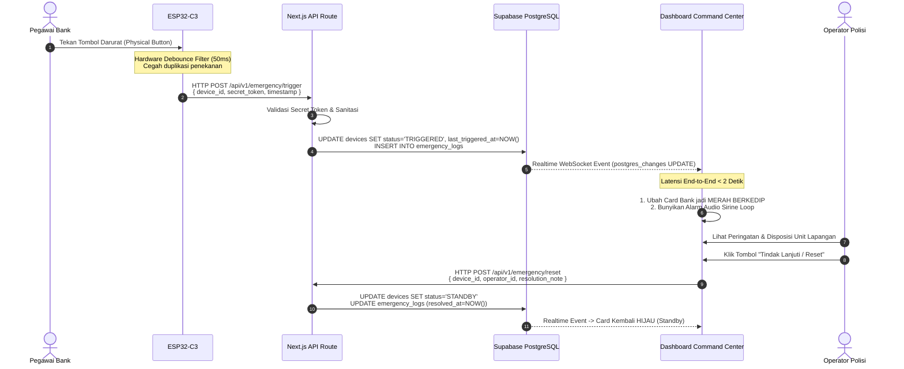

# Product Requirements Document (PRD)
## Proyek: Bank Emergency Monitoring System (BEMS)
### Unit: Command Center - Polresta Bandar Lampung

---

### Informasi Dokumen
| Atribut | Keterangan |
| :--- | :--- |
| **Nama Proyek** | BEMS (Bank Emergency Monitoring System) |
| **Versi Dokumen** | 1.0.0 (MVP Release) |
| **Status** | *Approved for Development* |
| **Pemilik Produk (Product Lead)** | Senior Product Manager & System Architect |
| **Pemangku Kepentingan Utama** | Bagian Operasional (Bag Ops) & SPKT Polresta Bandar Lampung, Asosiasi Perbankan Daerah |
| **Target Rilis MVP** | Q4 2024 / Q1 2025 |

---

## 1. Ringkasan Eksekutif (Executive Summary)

### 1.1 Latar Belakang & Masalah
Tindak kriminal perampokan dan ancaman kekerasan bersenjata di lingkungan perbankan membutuhkan respons taktis yang sangat cepat dari aparat kepolisian. Selama ini, pelaporan darurat masih menghadapi kendala krusial:
1. **Keterlambatan Pelaporan Konvensional:** Pegawai bank harus menelepon call center 110 atau kontak darurat polsek setempat saat situasi genting, yang berisiko tinggi diketahui pelaku dan memakan waktu 2–5 menit.
2. **Ketiadaan Validasi Status Perangkat:** Sistem alarm silent lama sering kali tidak diketahui apakah dalam kondisi aktif, rusak, atau terputus jaringannya sebelum insiden terjadi.
3. **Visibilitas Komando yang Terfragmentasi:** Operator ruang pantau (*Command Center*) Polresta Bandar Lampung kesulitan memetakan lokasi bank yang mengalami darurat secara instan beserta informasi kontak darurat cabang terkait.

### 1.2 Solusi Produk: BEMS
**BEMS (Bank Emergency Monitoring System)** adalah platform pemantauan keamanan nirkabel *real-time* berbasis web untuk ruang pantau (*command center*) Polresta Bandar Lampung. Sistem ini terhubung langsung dengan perangkat keras *panic button* berbasis mikrokontroler **ESP32-C3** yang ditempatkan secara ergonomis dan tersembunyi di meja teller/keamanan bank.

Ketika tombol ditekan:
* Sinyal darurat dikirim secara aman melalui HTTP POST.
* Layar *dashboard* pemantauan di Command Center seketika berubah menjadi indikator merah berkedip disertai peringatan audio dengan latensi **di bawah 2 detik**.
* Lokasi dan rincian bank langsung teridentifikasi untuk percepatan pengerahan unit patroli terdekat (Sat Samapta / Sat Reskrim).

---

## 2. Tujuan Bisnis & Sasaran MVP (Goals & Objectives)

### 2.1 Tujuan Strategis (Business Goals)
1. **Memangkas Response Time (Golden Period):** Memangkas waktu transmisi laporan kejadian dari rata-rata 3 menit menjadi < 2 detik ke Command Center.
2. **Meningkatkan Keandalan Proteksi Objek Vital:** Menjamin kesiapsiagaan seluruh unit alarm bank di wilayah hukum Bandar Lampung secara berkala (24/7).
3. **Efisiensi Disposisi Taktis:** Memberikan kejelasan data situasional bagi perwira pengendali untuk menginstruksikan unit patroli presisi.

### 2.2 Sasaran Spesifik MVP (MVP Objectives)
* **Validasi Real-time Sub-2 Detik:** Membuktikan integrasi end-to-end antara penekanan tombol fisik ESP32-C3 hingga rendering perubahan UI di dashboard Next.js berlangsung < 2 detik.
* **Validasi Keandalan Konektivitas (Heartbeat Engine):** Memastikan sistem secara otomatis mendeteksi jika perangkat offline atau sambungan internet bank terputus dalam batas toleransi waktu yang ditentukan.
* **Usabilitas UI Ruang Pantau:** Menghadirkan antarmuka visual modern, kontras jelas, dan responsif yang siap diproyeksikan pada layar *Video Wall* Command Center maupun monitor kerja operator.

---

## 3. Persona Pengguna (User Personas)

### 3.1 Operator Command Center Polresta (Primary Persona)
| Atribut | Profil |
| :--- | :--- |
| **Nama Persona** | Bripka Dimas Pratama (Operator Ruang Pantau SPKT) |
| **Tanggung Jawab** | Mengawasi layar pantau, menerima notifikasi insiden, memverifikasi kondisi darurat, mengabarkan unit patroli lapangan, dan mendokumentasikan log insiden. |
| **Kebutuhan Kritis** | - Indikator visual mencolok (merah berkedip) yang langsung menarik perhatian dari kejauhan.<br>- Notifikasi audio alarm yang jelas.<br>- Tombol reset/tindak lanjut yang mudah diakses untuk meredakan status darurat setelah penanganan.<br>- Status kesehatan perangkat (online/offline) yang transparan. |
| **Tantangan** | Kelelahan visual (*alarm fatigue*) jika UI terlalu ramai atau terdapat alarm palsu yang tidak dapat dilacak statusnya. |

### 3.2 Teller / Petugas Keamanan Bank (Secondary Persona)
| Atribut | Profil |
| :--- | :--- |
| **Nama Persona** | Siti Rahmawati (Teller Bank Mitra di Bandar Lampung) |
| **Tanggung Jawab** | Melayani nasabah di counter depan; menjadi garda pertama yang mengaktifkan sinyal bahaya saat ada indikasi perampokan atau ancaman fisik. |
| **Kebutuhan Kritis** | - Tombol fisik ringkas, tersembunyi di bawah meja (*under-desk mount*).<br>- Aktivasi sekali tekan (*one-touch trigger*) tanpa prosedur rumit.<br>- Sistem tidak menimbulkan suara di lokasi bank agar pelaku tidak terprovokasi (*silent trigger*). |
| **Tantangan** | Jaringan Wi-Fi internal bank yang mungkin fluktuatif atau mengalami pemadaman listrik. |

---

## 4. Arsitektur Sistem & Aliran Data (Architecture & Data Flow)

### 4.1 Diagram Arsitektur Tingkat Tinggi
```
+-------------------------------------------------------------------------------+
|                             LOKASI BANK MITRA                                 |
|                                                                               |
|  [ Tombol Darurat Fisik ]                                                     |
|             | (GPIO Trigger / Interrupt)                                     |
|             v                                                                 |
|   +-------------------+                                                       |
|   |   ESP32-C3 SoC    | --- Heartbeat (Tiap 5 Mnt) ---> HTTP POST (Wi-Fi)     |
|   |  Firmware (C++)   | --- Emergency Trigger      ---> HTTP POST (Wi-Fi)     |
|   +-------------------+                                       |               |
+---------------------------------------------------------------|---------------+
                                                                | (Internet / HTTPS)
                                                                v
+-------------------------------------------------------------------------------+
|                       BACKEND ENGINE (NEXT.JS APP ROUTER)                     |
|                                                                               |
|   +----------------------------------------------------------------------+    |
|   | API Routes:                                                          |    |
|   |  - POST /api/v1/emergency/trigger (Payload verification & Timestamp) |    |
|   |  - POST /api/v1/emergency/heartbeat (Device state ping updater)      |    |
|   |  - POST /api/v1/emergency/reset (Operator acknowledge action)        |    |
|   +----------------------------------------------------------------------+    |
+-------------------------------------------------------------------------------+
                                        |
                 (Supabase Service Role / Postgres Mutation)
                                        v
+-------------------------------------------------------------------------------+
|                          SUPABASE (POSTGRESQL DB)                             |
|                                                                               |
|   Tables:                                                                     |
|    - `banks`: Profil bank & lokasi                                            |
|    - `devices`: ID Perangkat, API Key, Status (STANDBY/TRIGGERED/OFFLINE)     |
|    - `emergency_logs`: Riwayat insiden & penanganan operator                  |
|    - `heartbeat_logs`: Jejak audit detak jantung perangkat                    |
+-------------------------------------------------------------------------------+
                                        |
                 (Postgres Changes via Supabase Realtime / WebSocket)
                                        v
+-------------------------------------------------------------------------------+
|                 FRONT-END DASHBOARD (COMMAND CENTER POLRESTA)                 |
|                                                                               |
|   - Real-time Subscriber (`supabase-js` WebSocket client)                     |
|   - Reaktif State Management: Status Card berganti seketika                   |
|   - Alert Engine: Red Blinking CSS Animation + Web Audio Chime Loop           |
|   - Action Form: Modal konfirmasi "Tindak Lanjuti / Reset"                    |
+-------------------------------------------------------------------------------+
```

### 4.2 Alur Data Penekanan Tombol Darurat (Emergency Trigger Flow)


### 4.3 Alur Data Heartbeat & Deteksi Offline
1. **Transmisi Rutin:** Perangkat ESP32-C3 secara terjadwal setiap 5 menit mengirimkan HTTP POST ke `/api/v1/emergency/heartbeat` berisi status tegangan, sinyal RSSI, dan `device_id`.
2. **Pembaruan Basis Data:** Server memperbarui kolom `last_heartbeat_at` pada tabel `devices`.
3. **Pemeriksaan Status Aktif:** 
   - Supabase Edge Function / Background Cron Job di Next.js menjalankan evaluasi berkala setiap 60 detik.
   - Aturan: Jika `(Waktu_Sekarang - last_heartbeat_at) > 10 Menit` (melewatkan 2 kali siklus ping berturut-turut) dan status saat ini bukan `TRIGGERED`, maka status otomatis berubah menjadi `OFFLINE`.
4. **Pembaruan UI:** Event realtime memicu perubahan warna kartu di dashboard menjadi **Abu-abu (OFFLINE)**.

---

## 5. Kebutuhan Fitur Fungsional (Functional Requirements)

### Modul 1: Deteksi Bahaya Darurat (Emergency Trigger)
* **ID:** `FR-01`
* **Prioritas:** P0 (Kritis / Blocker)
* **Deskripsi:** Sistem harus mampu menangkap trigger fisik dari perangkat keras ESP32-C3 dan merefleksikannya ke dashboard secara instan tanpa perlu reload halaman.
* **Spesifikasi Perilaku:**
  * Kartu status bank yang bersangkutan seketika berubah latar belakang menjadi warna merah menyala dengan efek animasi berkedip (*pulsing/blinking* `animate-pulse`).
  * Menampilkan badge besar teks: `DARURAT / TRIGGERED`.
  * Menampilkan informasi kontekstual: Nama Bank, Kantor Cabang, Alamat Lengkap, Nomor Telepon Darurat Cabang, dan Waktu Persis Tombol Ditekan (format: `HH:mm:ss WIB`).
  * Mengaktifkan suara sirine peringatan terus-menerus melalui browser sampai operator merespons.
  * Kartu darurat otomatis melompat ke urutan teratas (*sticky priority pin*) pada grid dashboard.

### Modul 2: Sistem Detak Jantung & Pemantauan Perangkat (Heartbeat & Ping Monitoring)
* **ID:** `FR-02`
* **Prioritas:** P0 (Kritis)
* **Deskripsi:** Sistem memantau integritas perangkat keras dan koneksi jaringan bank secara berkelanjutan.
* **Spesifikasi Perilaku:**
  * ESP32-C3 mengirimkan sinyal ping setiap 5 menit (300 detik).
  * Toleransi keterlambatan adalah 2 siklus (10 menit).
  * Jika dalam kurun waktu > 10 menit server tidak menerima ping baru dari perangkat:
    * Status perangkat berubah dari `STANDBY` (Hijau) menjadi `OFFLINE` (Abu-abu netral).
    * Kartu bank menampilkan indikator `KONEKSI TERPUTUS / OFFLINE`.
    * Ditampilkan label waktu terakhir aktif, contoh: `Terakhir aktif: 12 menit yang lalu`.
  * Saat perangkat kembali menyala dan mengirim ping kembali, status otomatis pulih menjadi `STANDBY` (Hijau).

### Modul 3: Tindak Lanjut & Reset Status Darurat (Acknowledge & Reset)
* **ID:** `FR-03`
* **Prioritas:** P0 (Kritis)
* **Deskripsi:** Mekanisme bagi operator Polresta untuk meredakan status darurat setelah penanganan lapangan dikonfirmasi.
* **Spesifikasi Perilaku:**
  * Pada kartu yang berstatus merah (`TRIGGERED`), tersedia tombol aksi utama: **"Tindak Lanjuti / Reset"**.
  * Mengklik tombol memunculkan modal dialog verifikasi:
    * Nama Operator yang bertugas.
    * Catatan Tindakan Lapangan (contoh: *"Unit Samapta tiba di lokasi, situasi terkendali/aman"*).
  * Setelah tombol konfirmasi diklik:
    * Audio sirine berhenti.
    * Status perangkat diperbarui ke basis data menjadi `STANDBY`.
    * Kartu bank kembali ke tampilan normal warna **Hijau (Standby / Aman)**.
    * Log insiden tersimpan permanen di basis data untuk kebutuhan rekapitulasi laporan pimpinan.

### Modul 4: Manajemen Direktori Bank & Perangkat (Device & Bank Registry)
* **ID:** `FR-04`
* **Prioritas:** P1 (Penting)
* **Deskripsi:** Penyimpanan data statis institusi bank mitra untuk identifikasi visual operator.
* **Spesifikasi Data:**
  * ID Bank & ID Perangkat (MAC Address / Device UUID).
  * Nama Instansi Bank (misal: Bank Mandiri KC Tanjung Karang, BRI Unit Kedaton, BCA KCU Malahayati).
  * Alamat Lengkap & Titik Koordinat GPS (opsional untuk tahap MVP).
  * Kontak Penanggung Jawab Keamanan / Branch Manager.

---

## 6. Kebutuhan Non-Fungsional (Non-Functional Requirements)

### 6.1 Desain Antarmuka & Pengalaman Pengguna (UI/UX)
* **Tema Visual:**
  * **Sidebar:** Hijau gelap profesional (`#0D3B2E` / `#0F2F24` Deep Emerald) yang mencerminkan ketegasan, kewibawaan institusi kepolisian, dan kontras tajam terhadap teks navigasi.
  * **Latar Belakang Konten:** Abu-abu sangat terang / putih keperakan (`#F8FAFC` Slate-50) untuk keterbacaan tinggi di ruangan terang Command Center.
  * **Kartu Status Bank:**
    * Berbentuk kartu modern (*white card container*) dengan sudut membulat lebar (`rounded-2xl`).
    * Bayangan lembut (*soft ambient shadow* `shadow-sm hover:shadow-md`).
    * Tipografi modern menggunakan font Google Inter / Outfit yang bersih dan mudah dipindai cepat (*high scannability*).
* **Indikator Warna Status Semantik (Visual Hierarchy):**
  | Status | Warna Utama | Aksen / Efek Visual | Kondisi Operasional |
  | :--- | :--- | :--- | :--- |
  | **STANDBY (Aman)** | Hijau Lembut (`#10B981` / Emerald-500) | Badge hijau pudar, titik pulsa hijau statis | Alat terhubung, tidak ada ancaman |
  | **TRIGGERED (Darurat)**| Merah Menyala (`#EF4444` / Rose-600) | Latar merah muda, border merah menyala, `animate-pulse` berkedip | Tombol darurat sedang aktif ditekan |
  | **OFFLINE (Mati/Putus)**| Abu-abu Netral (`#94A3B8` / Slate-400)| Badge abu-abu pudar, ikon status mati | Hilang kontak > 10 menit |

### 6.2 Performa & Latensi
* **End-to-End Latency Target:** Waktu dari tombol fisik ESP32-C3 ditekan hingga kartu bank di dashboard Command Center berubah warna menjadi merah adalah **maksimal < 2.0 detik** (dengan koneksi internet standar 4G/Wi-Fi).
* **Supabase Realtime Throughput:** Menggunakan WebSocket native Supabase dengan efisiensi pengiriman paket kecil (payload JSON < 1KB).
* **Stabilitas Sesi Browser:** Frontend Next.js dioptimalkan untuk beroperasi **24 jam non-stop** tanpa kebocoran memori (*zero memory leak*), tanpa memerlukan refresh manual (*F5*).

### 6.3 Keamanan Sistem (Security)
* **Autentikasi Perangkat (IoT Security):** Setiap request HTTP POST dari ESP32-C3 wajib menyertakan token otentikasi unik di HTTP Header:
  `X-Device-Token: <SECRET_HASH_KEY>`.
* **Proteksi Anti-Spam / Debounce:** Mikrokontroler ESP32-C3 menerapkan perangkat lunak *hardware interrupt debounce* minimal 3.000 ms (3 detik) untuk mencegah pengiriman paket ganda bertubi-tubi saat tombol ditekan panik berulang kali.
* **Otentikasi Operator:** Halaman dashboard diproteksi dengan otentikasi berbasis sesi (NextAuth.js / Supabase Auth) untuk memastikan hanya personel kepolisian terotorisasi yang dapat melakukan *Acknowledge / Reset*.

---

## 7. Skema Basis Data & API Contract

### 7.1 Skema Tabel Supabase (PostgreSQL)
```sql
-- 1. Tabel Master Bank
CREATE TABLE banks (
    id UUID PRIMARY KEY DEFAULT gen_random_uuid(),
    code VARCHAR(50) UNIQUE NOT NULL,
    name VARCHAR(150) NOT NULL,
    branch_name VARCHAR(150) NOT NULL,
    address TEXT NOT NULL,
    emergency_contact VARCHAR(50) NOT NULL,
    created_at TIMESTAMPTZ DEFAULT NOW()
);

-- 2. Tabel Perangkat IoT
CREATE TYPE device_status AS ENUM ('STANDBY', 'TRIGGERED', 'OFFLINE');

CREATE TABLE devices (
    id UUID PRIMARY KEY DEFAULT gen_random_uuid(),
    bank_id UUID REFERENCES banks(id) ON DELETE CASCADE,
    device_uid VARCHAR(100) UNIQUE NOT NULL, -- MAC Address / Serial
    auth_token VARCHAR(255) NOT NULL,
    status device_status DEFAULT 'OFFLINE',
    last_heartbeat_at TIMESTAMPTZ,
    last_triggered_at TIMESTAMPTZ,
    created_at TIMESTAMPTZ DEFAULT NOW(),
    updated_at TIMESTAMPTZ DEFAULT NOW()
);

-- 3. Tabel Log Insiden Darurat
CREATE TABLE emergency_logs (
    id UUID PRIMARY KEY DEFAULT gen_random_uuid(),
    device_id UUID REFERENCES devices(id),
    triggered_at TIMESTAMPTZ NOT NULL DEFAULT NOW(),
    resolved_at TIMESTAMPTZ,
    operator_name VARCHAR(100),
    resolution_notes TEXT,
    created_at TIMESTAMPTZ DEFAULT NOW()
);
```

### 7.2 Spesifikasi Endpoint API (Next.js App Router)

#### 1. Emergency Trigger (Dari ESP32-C3)
* **Endpoint:** `POST /api/v1/emergency/trigger`
* **Headers:**
  * `Content-Type: application/json`
  * `X-Device-Token: b3m5-p0lr35t4-53cr3t-t0k3n`
* **Request Body:**
  ```json
  {
    "device_uid": "ESP32C3-BDL-001",
    "timestamp": "2026-10-19T08:45:00.000Z"
  }
  ```
* **Response (200 OK):**
  ```json
  {
    "success": true,
    "message": "Emergency signal received and broadcasted.",
    "status": "TRIGGERED"
  }
  ```

#### 2. Heartbeat / Ping (Dari ESP32-C3)
* **Endpoint:** `POST /api/v1/emergency/heartbeat`
* **Headers:**
  * `Content-Type: application/json`
  * `X-Device-Token: b3m5-p0lr35t4-53cr3t-t0k3n`
* **Request Body:**
  ```json
  {
    "device_uid": "ESP32C3-BDL-001",
    "rssi": -65,
    "uptime_seconds": 86400
  }
  ```
* **Response (200 OK):**
  ```json
  {
    "success": true,
    "status": "ACK",
    "server_time": "2026-10-19T08:45:02.120Z"
  }
  ```

#### 3. Reset Status (Dari Dashboard Operator)
* **Endpoint:** `POST /api/v1/emergency/reset`
* **Headers:**
  * `Content-Type: application/json`
  * `Authorization: Bearer <SESSION_TOKEN>`
* **Request Body:**
  ```json
  {
    "device_uid": "ESP32C3-BDL-001",
    "operator_name": "Bripka Dimas Pratama",
    "resolution_notes": "Unit Samapta tiba di lokasi, situasi telah terkendali aman."
  }
  ```
* **Response (200 OK):**
  ```json
  {
    "success": true,
    "message": "Device status reset to STANDBY.",
    "status": "STANDBY"
  }
  ```

---

## 8. Kriteria Penerimaan (Acceptance Criteria)

Sistem MVP dinyatakan lulus uji lapangan dan siap diserahterimakan jika memenuhi seluruh kriteria pengujian berikut:

| Kode Uji | Skenario Pengujian | Langkah Pengujian | Hasil yang Diharapkan (Acceptance Criteria) |
| :--- | :--- | :--- | :--- |
| **UAT-01** | **Pemicu Darurat (Panic Trigger)** | Pegawai menekan tombol fisik darurat pada modul ESP32-C3. | 1. Kartu status bank pada dashboard seketika berganti menjadi latar merah dengan animasi kedip (`animate-pulse`).<br>2. Audio alarm peringatan berbunyi otomatis di browser.<br>3. Seluruh proses dari tombol ditekan hingga layar berkedip tercapai dalam waktu **< 2.0 detik**.<br>4. Tidak terjadi *full-page reload*. |
| **UAT-02** | **Detak Jantung & Deteksi Putus Jaringan** | Cabut kabel daya atau putuskan koneksi Wi-Fi pada perangkat ESP32-C3 selama > 10 menit. | 1. Sistem mendeteksi ketiadaan sinyal ping setelah melewati ambang batas 10 menit.<br>2. Status kartu bank terkait otomatis beralih dari Hijau (Standby) menjadi Abu-abu netral bertuliskan `OFFLINE`.<br>3. Ketika kabel daya/Wi-Fi dipasang kembali dan ping diterima, status otomatis kembali menjadi Hijau (Standby). |
| **UAT-03** | **Proses Reset Operator Polisi** | Operator mengklik tombol "Tindak Lanjuti / Reset" pada bank yang sedang berstatus merah darurat. | 1. Muncul modal dialog konfirmasi data tindak lanjut.<br>2. Setelah formulir dikirim, audio alarm berhenti berbunyi seketika.<br>3. Status kartu bank kembali berwarna Hijau (Standby/Aman).<br>4. Rekaman waktu reset dan nama operator tersimpan valid pada tabel `emergency_logs`. |
| **UAT-04** | **Pencegahan Debouncing / Tombol Tertekan Berkali-kali** | Tombol fisik ditekan secara acak dan bertubi-tubi sebanyak 10 kali dalam kurun 3 detik. | Perangkat ESP32-C3 hanya memicu 1 kali pengiriman payload darurat ke API server; sistem backend tidak mengalami duplikasi request ganda yang berlebihan. |
| **UAT-05** | **Uji Tahan Operasi 24 Jam Dashboard** | Buka dashboard di browser Google Chrome pada PC Command Center dan biarkan menyala selama 24 jam tanpa ditutup. | Memori browser tetap stabil (< 200 MB penggunaan RAM), koneksi WebSocket Supabase Realtime secara otomatis pulih (*auto-reconnect*) jika sempat terjadi gangguan jaringan sementara. |

---

## 9. Rencana Kerja & Roadmap Pengembangan MVP

| Fase | Durasi | Target Utama / Milestone |
| :--- | :--- | :--- |
| **Sprint 1: Desain & Skema DB** | 1 Minggu | Finalisasi skema database Supabase, konfigurasi Next.js App Router, penyiapan Tailwind CSS tokens (sidebar emerald, card modern). |
| **Sprint 2: Firmware IoT & API Ingestion** | 1 Minggu | Pemrograman C++ ESP32-C3 (Wi-Fi, HTTP POST client, hardware debounce interrupt, timer heartbeat 5 menit). Pembuatan API routes `/trigger`, `/heartbeat`, dan `/reset`. |
| **Sprint 3: Dashboard Real-time & Audio** | 1 Minggu | Implementasi Supabase Realtime Subscription di Next.js, pembuatan komponen Card Status (Merah berkedip, Hijau, Abu-abu), integrasi audio sirine, dan modal reset. |
| **Sprint 4: Pengujian Lapangan & UAT** | 1 Minggu | Pengujian integrasi hardware-to-cloud di Polresta Bandar Lampung bersama 1-2 unit percontohan di bank mitra, validasi latensi < 2 detik. |

---
*Dokumen ini disusun sebagai panduan teknis resmi implementasi MVP BEMS Polresta Bandar Lampung. Setiap perubahan spesifikasi harus melalui mekanisme Change Request kepada Product Manager.*
